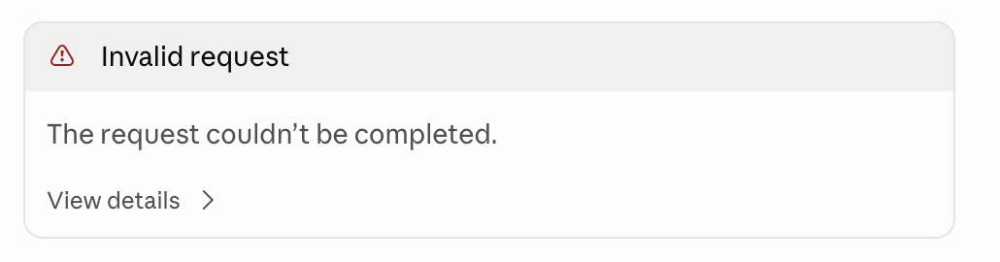
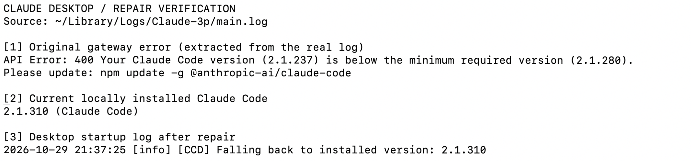

# Claude 桌面端已经更新，为什么还报错？我把两个问题一起修好了

我明明已经下载了新版 Claude 桌面端，发一句问候，界面却只给我一个 **Invalid request**。

排查之后才发现，桌面端实际启动的 Claude Code 还是 **2.1.237**，而当前网关要求的最低版本是 **2.1.280**。修好这一层，界面又提示 Haiku 模型不可用。

最终，两处问题都解决了：桌面端使用了本机已有的 **2.1.310**，Haiku 的模型 ID 也补上了缺失的日期后缀。下面把这次真实的定位、修复和验证过程记录下来。

> 实测日期：2026 年 10 月 29 日。环境为 macOS、Claude Desktop 4.29.0、Code 模式和第三方 Gateway 配置。文中的版本要求、模型名称及缓存路径均来自本次环境，不代表所有网关和客户端版本。配图全部为真实截图，仅裁去无关区域；终端图为修复后重新读取真实日志、执行版本检查时拍摄。

## 01｜界面只说请求失败，真正的原因藏在日志里

最初的报错非常简短：

```text
Invalid request
The request couldn’t be completed.
```



*图 1：最初的真实报错。仅凭这张卡片，还无法判断是网络、认证、模型还是版本问题。*

我的第一反应也是：“我已经下载最新版了呀。”

但这次排障最关键的一步，是先确认**到底哪个程序在报错、它实际运行的是哪一版**。

这台机器同时存在普通 Claude 配置目录和第三方网关配置目录。截图中的账号使用 Gateway，因此继续检查的是 `Claude-3p` 对应的日志，而不是只看普通 `Claude` 目录。

在本次机器上，关键日志位于：

```text
~/Library/Logs/Claude-3p/main.log
```

里面记录的拒绝原因很明确：

```text
API Error: 400 Your Claude Code version (2.1.237) is below the minimum required version (2.1.280).
```

这条记录把范围收窄了：**当前请求被网关以“Claude Code 版本过低”为由拒绝。** 此时无需凭感觉更换 API Key，也不必把所有模型配置推倒重来。

## 02｜桌面端与终端，原来使用了两份 Claude Code

接着检查终端里的版本：

```bash
command -v claude
claude --version
```

结果是：

```text
2.1.310 (Claude Code)
```

终端明明已经超过最低要求，桌面端为什么还在报 2.1.237？

继续看启动日志，发现桌面端使用的是自己的独立缓存：

```text
~/Library/Application Support/Claude-3p/claude-code/
```

它没有直接调用终端中 `command -v claude` 找到的那份程序。

| 检查对象 | 本次查到的版本或要求 |
| --- | --- |
| Claude 桌面应用 | 4.29.0 |
| 终端里的 Claude Code | 2.1.310 |
| 桌面端修复前实际启动的 Claude Code | 2.1.237 |
| 当前网关要求的最低 Claude Code 版本 | 2.1.280 |
| 桌面端原计划下载的内部组件 | 2.1.309 |

桌面应用版本和 Claude Code 组件版本是两套编号，不能直接拿来比较。

日志进一步解释了旧组件为什么还会被启动：**桌面端下载 2.1.309 连续失败，随后回退到缓存中的 2.1.237。** 日志里既有下载连接失败，也有明确的回退记录。

所以，“客户端已经更新”与“内部运行组件仍然很旧”在这台机器上同时成立。

## 03｜复用本机已有的新版组件，让桌面端先恢复运行

确认原因后，首先尝试下载桌面端原本要求的官方组件包。直连没有成功，通过现有系统代理下载也失败了。

这时，本机已经有一份可正常执行的 2.1.310。于是，修复转向复用这份组件。

整个过程保留了几个必要的校验：

1. 执行本机程序的 `--version`，确认版本确实是 2.1.310。
2. 使用 macOS 的 `codesign --verify --strict` 校验其签名，并检查签名身份。
3. 将验证过的程序安装到桌面端独立缓存的新增版本目录，记录文件校验信息，保留旧版用于回退。
4. 正常退出并重新打开 Claude，再检查启动日志和实际进程路径。

这里没有修改网关的最低版本要求，也没有把旧程序伪装成新版。

重启后，桌面端日志出现了新的记录：

```text
[CCD] Falling back to installed version: 2.1.310
```

进程路径也指向新增的 2.1.310 缓存目录。两项证据相互对应，确认桌面端实际用上了新版。



*图 2：修复后补拍的真实终端核验。上半部分读取原始错误日志，下半部分展示当前 CLI 版本和桌面端的新版启动记录；不是故障发生时的终端录像。*

需要把修复边界说清楚：**这一步恢复了本机桌面端的组件可用性，官方下载链路本身并没有修通。** 日志中的“回退”仍然存在，只是现在回退到的是符合网关要求的 2.1.310。

缓存布局属于客户端内部实现，这次操作是针对已确认的本机环境进行的修复，不建议把版本号、目录名或校验标记照抄到其他机器。遇到类似问题，应先确认自己桌面端实际启动的文件路径。

## 04｜第二个报错：Haiku 的名字少了一段

版本问题解决后，界面上的另一个提示也需要处理：

```text
Configured model not available
Gateway couldn’t serve claude-haiku-4-5.
```


*图 3：第二个真实报错。它指向具体的模型 ID，与前面的组件版本错误不同。*

这条提示并不能直接证明账号失效，也不能证明所有模型都不可用。日志中，标题生成相关请求使用了 `claude-haiku-4-5`，网关对这个名称返回了 HTTP 404。

于是继续检查当前生效的网关配置，并使用已有认证读取网关的 `/v1/models`。

模型列表里确实有 Haiku，但名称是：

```text
claude-haiku-4-5-20251001
```

而本地配置写的是：

```text
claude-haiku-4-5
```

差别就是末尾的 `-20251001`。

| 项目 | 本次检查结果 |
| --- | --- |
| 本地配置的 Haiku ID | `claude-haiku-4-5` |
| 网关模型列表中的 Haiku ID | `claude-haiku-4-5-20251001` |
| 原名称的请求结果 | HTTP 404 |
| 完整名称的最小请求结果 | HTTP 200，返回 `OK` |

**模型的显示名称相近，不代表 API 接受的 ID 可以随意省略。** 是否支持不带日期的别名，取决于实际使用的服务端；这次网关需要列表中的完整名称。

## 05｜先测试正确模型，再只改一个字段

没有直接把配置改完就宣布成功，而是先用完整模型 ID 发起了一个极短的请求：要求模型只回复 `OK`，输出上限设为 16 tokens。

实际结果如下。这段是测试结果的文字摘录，不是截图：

```text
HTTP 200
type: message
model: claude-haiku-4-5-20251001
reply: OK
```

确认网关确实能调用该模型后，才修改当前生效的配置文件。

本次文件位于：

```text
~/Library/Application Support/Claude-3p/configLibrary/<当前配置 ID>.json
```

其中 `<当前配置 ID>` 是占位符，需要以当前生效的配置为准。

修改前先备份原文件，随后只调整 `inferenceModels` 数组中 Haiku 那一项的 `name`：

```diff
- "name": "claude-haiku-4-5"
+ "name": "claude-haiku-4-5-20251001"
```

最后重新解析 JSON，并对比修改前后的内容，确认差异仅为这个模型 ID。其他模型和认证配置都保留原值。

## 06｜最终验收：警告消失，聊天也正常了

重启 Claude 后，黄色的模型不可用提示消失了。界面中的问候也已经得到了正常回复：


*图 4：修复后的实际界面。保留了用户输入和模型回复，裁去了账号、其他聊天记录及项目侧栏。*

这次验收没有只看“红字不见了”，而是分别确认了三件事：

- **运行组件**：桌面端实际启动了 2.1.310。
- **网关调用**：完整 Haiku ID 的最小请求得到 HTTP 200 和正常内容。
- **客户端界面**：重启后警告消失，聊天已有正常回复。

回看整次排查，两个问题各自有一条完整的证据链：

**Invalid request → 日志显示版本过低 → 桌面端使用独立旧缓存 → 换用验证过的新版组件。**

**Model not available → 日志显示指定模型返回 404 → 查询网关模型列表 → 补全模型 ID 并实测。**

以后再遇到“明明已经更新，为什么还报错”，我会先检查实际运行路径；遇到“模型不可用”，就先核对服务端接受的完整模型 ID。

这两次修复的共同点，是每改一处，都有对应的日志、请求结果或真实界面来验证。
